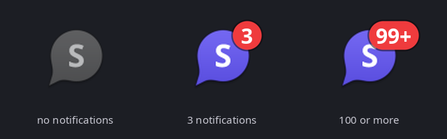

<p align="center">
  
</p>

<h1 align="center">Slacker</h1>

<p align="center">
  A tiny World of Warcraft: Forever addon that answers one question while you play: <b>do I need to check Slack?</b>
</p>

<p align="center">
  <a href="https://github.com/nikpietanze/Slacker/releases/latest"></a>
  <a href="LICENSE"></a>
</p>

<p align="center">
  
</p>

- **One small icon.** A speech bubble with an **S** that you can put anywhere. It's muted while Slack has nothing for you.
- **A badge when it matters.** A red badge shows how many Slack notifications you haven't dealt with, up to `99+`. Hover for `Slack: 3 notifications` and the time of the last one.
- **Clears itself.** Read Slack (or clear its notifications) and the badge goes away.
- **Edit Mode support.** Move and size the icon in Blizzard's Edit Mode, with a position saved for each Edit Mode layout.

No message previews, no channel names, no senders. Only a number.

## How it gets the count

A small **companion app** runs on your computer and watches the notifications Slack already shows through your operating system. It hands the count to the addon.

```
Slack desktop ──► OS notifications ──► companion (local) ──► Slacker addon
```

- **No Slack connection.** The companion never talks to Slack: no tokens, no OAuth, no bot, no workspace app, no admin approval.
- **No network at all.** Nothing about Slack or WoW leaves your computer, and nothing is sent to Slack.

WoW addons can't open sockets or read files, so the companion writes a tiny blank image into the addon's folder, and the image's width and height encode the count. The addon reloads it about once a second. The details are in [docs/HOW-IT-WORKS.md](docs/HOW-IT-WORKS.md).

| Your computer | What the companion watches | When the badge clears |
|---|---|---|
| Windows 10/11 | Slack's notifications in the Windows notification center | When you focus Slack, or the notifications are cleared |
| macOS | Slack's Dock badge (its count of DMs, mentions and keywords) | As you read, when Slack clears its badge |
| Linux | Slack's desktop notifications on the session D-Bus, plus its launcher badge | When Slack closes them, or you dismiss them |

## Options

Everything is under **Esc → Options → AddOns → Slacker** (or type `/slack`, right-click the icon, or click Slacker in the minimap's addons menu):

| Section | Settings |
|---|---|
| Icon | Lock position, tooltip, icon size (20 to 64 px), badge size, opacity, plus Move and Reset |
| New notifications | Flash, sound (built-in or your SharedMedia sounds), plus Test |
| Companion app | Remind me when it isn't running, plus Get it (shows the download link) |

The panel's **Defaults** button restores everything. To move the icon, click **Move** (or type `/slack move`) to open Edit Mode, then drag it. Select it there to change its size and opacity. While it's unlocked, you can also just drag it.

## Commands

| Command | What it does |
|---|---|
| `/slack` | Open the options |
| `/slack setup` | Show the companion app's download link |
| `/slack test` | Show sample counts on the badge for a few seconds |
| `/slack move` | Open Edit Mode to move the icon |
| `/slack unlock` / `/slack lock` | Drag the icon without Edit Mode, then lock it |
| `/slack reset` | Put the icon back in its default spot |
| `/slack status` | Print client, bridge and layout details for bug reports |
| `/slack debug` | Print every read of the companion's bridge file |

`/slacker` works too.

## Install

### 1. The addon

Download the latest `Slacker-*.zip` from [Releases](https://github.com/nikpietanze/Slacker/releases/latest) and extract it into your AddOns folder:

```
World of Warcraft/_forever_/Interface/AddOns/Slacker/Slacker.toc
```

You can also clone this repo into that folder as `Slacker`. Target client: WoW Forever, Interface `16001`.

### 2. The companion app

WoW addons can't see other programs, so Slacker needs a small free app on your computer that tells it what Slack is showing. Download it from the [latest release](https://github.com/nikpietanze/Slacker/releases/latest):

| Your computer | Download | Then |
|---|---|---|
| Windows 10/11 | `Slacker-Companion-Windows.exe` | Double-click it. If Windows says *"Windows protected your PC"*, click **More info → Run anyway**. |
| macOS 11+ | `Slacker-Companion-macOS.zip` | Unzip it and open **Slacker Companion**. The first time, macOS blocks it: open **System Settings → Privacy & Security** and click **Open Anyway**. |
| Linux | `Slacker-Companion-Linux-x64` (or `-arm64`) | Make it executable (`chmod +x`) and run it. |

That's it. It installs itself, starts by itself when you log in, and puts a speech bubble in your system tray (Windows, Linux) or menu bar (macOS). The bubble's menu shows your Slack count, whether it found the WoW addon, a **Start when I log in** switch, and **Quit**. It finds WoW and the addon on its own, in either order.

Forgot this step? In game, the Slacker icon says the companion isn't running. Click it for the download link (or type `/slack setup`).

**One Slack setting to check:**

- **Windows:** Slack's notifications have to go through Windows, not Slack's own pop-ups: **Slack → Settings → Notifications**. That's the default.
- **macOS:** Slack has to be allowed to badge its Dock icon: **System Settings → Notifications → Slack → Badge application icon**. That's the default too.

<details>
<summary>Advanced: command line</summary>

The companion is also a command-line tool (`slacker-companion` once installed):

```
slacker-companion doctor             what it can see, and which addon folders it found
slacker-companion demo               cycle sample counts on the in-game badge
slacker-companion run [--no-tray]    run in the foreground
slacker-companion autostart on|off
Flags: --wow-dir DIR  --addon-dir DIR  --interval 1s  --log FILE  -v
```

It installs to `%LOCALAPPDATA%\Programs\Slacker` (Windows), `~/Applications/Slacker Companion.app` (macOS) or `~/.local/bin` (Linux). If your WoW folder is somewhere unusual, run `autostart on --wow-dir "<folder containing _forever_>"` once.
</details>

### 3. Check it works

Have someone send you a Slack DM while you're in game. Within a second or two, the icon gets a red badge. You can also click **Test** in Slacker's options to see the badge at any time.

If the badge only changes after `/reload`, see [Troubleshooting](docs/TROUBLESHOOTING.md#the-badge-only-updates-after-reload).

## Good to know

- **Live updates rely on the game re-reading a changed texture file.** This hasn't been confirmed on a live client yet, and `demo` tells you in a minute. If the client caches the file, the badge still corrects on every `/reload`.
- **Clicking the icon can't switch to Slack.** Addons can't launch or focus other programs.
- **Terms of service.** The addon uses only the public addon API, and the companion only writes a file inside the addon's own folder, much as the WeakAuras Companion does. It doesn't read game memory or send input. Blizzard hasn't commented on this kind of file feed, so use it at your own discretion.

## Bugs and ideas

Open an [issue](https://github.com/nikpietanze/Slacker/issues). For bugs, include the output of `/slack status` and `slacker-companion doctor`, plus any Lua error text (BugSack makes this easy). Pull requests are welcome. See [CONTRIBUTING.md](CONTRIBUTING.md).

## License

MIT. See [LICENSE](LICENSE).

Slacker bundles these libraries unmodified, each under its own license in its folder under `Libs`:

- [LibStub](https://www.wowace.com/projects/libstub) (public domain)
- [LibEditMode](https://github.com/p3lim-wow/LibEditMode) by p3lim (custom license that allows bundling unmodified)

The "S" in the icon is drawn from [Noto Sans](https://fonts.google.com/noto/specimen/Noto+Sans) Bold (SIL Open Font License).

*Not affiliated with Slack Technologies or Blizzard Entertainment.*
